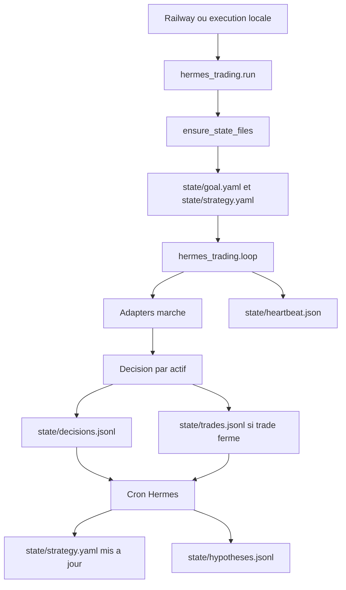

# Architecture

## Vue d'ensemble

Hermes Trading separe trois responsabilites:

- Collecte de marche: les adapters recuperent prix, news, donnees on-chain et macro.
- Decision: la boucle applique `state/strategy.yaml` a chaque actif suivi, avec des surcharges optionnelles par symbole.
- Amelioration: Hermes ou le fallback local propose une seule modification de strategie a la fois.

Le code local comporte un adaptateurKraken live soumis aux confirmations et protections d'execution. Le service verifie le12octobre2026 fonctionne en training avec la permission de vrais ordres desactivee. Le worker apparie candidat `hermes_trading.paired_worker` utilise des cycles simules; il reste non deploye et non active. Le diagramme ci-dessous decrit la voie historique, pas encore la nouvelle experimentation. Sa supervision externe unique, ses huit comptesEUR et ses controles sont documentes dans `research/runs/paired-release-v1/RELEASE_AND_RECOVERY.md`.

## Flux principal

## Composants

`hermes_trading/run.py`

- Cree les fichiers d'etat manquants.
- Lit les actifs depuis `--assets`, puis `HERMES_TRADING_ASSETS`, puis `state/goal.yaml`.
- Garde `--asset` comme actif principal historique quand aucune liste n'est fournie.
- Lance la boucle asynchrone.

`hermes_trading/loop.py`

- Normalise le mode `paper`, `training`, `train` ou `demo` en execution simulee.
- Refuse le live si les variables de confirmation ne sont pas exactes.
- Resout la strategie effective de chaque actif via la strategie globale et `symbols.<asset>`.
- Evalue chaque actif.
- Ecrit chaque decision dans `decisions.jsonl`.
- Ecrit uniquement les trades fermes dans `trades.jsonl`.
- Met a jour `heartbeat.json` a chaque cycle.

`hermes_trading/reflect.py`

- En mode fallback, lit `trades.jsonl` et modifie une variable.
- En mode Hermes, demande une proposition JSON a la CLI `hermes`.
- Peut appliquer une proposition globale ou une proposition ciblant un actif precis via le champ `asset`.
- Archive la strategie precedente dans `state/history`.

`hermes_trading/adapters/price.py`

- Utilise `ccxt`.
- Exchange par defaut: `kraken`.
- Recupere `ticker` et bougies `1h`.

`hermes_trading/adapters/onchain.py`

- Utilise Glassnode si `GLASSNODE_API_KEY` est disponible.
- Sinon utilise `blockchain.info`.

`hermes_trading/adapters/news.py`

- Utilise NewsAPI si `NEWS_API_KEY` est disponible.
- Sinon lit le flux RSS CoinDesk.

`hermes_trading/adapters/macro.py`

- Utilise `yfinance`.
- Recupere les clotures recentes de `SPY` et `DX-Y.NYB`.

Tous les adapters retournent un payload avec `schema_version: 1`. Une version inattendue leve `SchemaError` et arrete le cycle au lieu d'ecrire des donnees ambigues.

## Etat persistant

En local, l'etat est dans `state/`.

Sur Railway, le dossier persistant est le volume monte sur `/app/state`. C'est la source de verite du worker deploye.

## Multi-trading

Le worker traite les actifs sequentiellement dans un meme cycle. La strategie globale sert de socle commun, puis `symbols` permet d'ajuster uniquement les actifs qui le justifient.

Actifs suivis actuellement:

- `BTC/USDT`
- `ETH/USDT`
- `XRP/USDT`
- `SHIB/USDT`
